<h1 align="center"> 观鱼</h1>

斗鱼网页增强脚本：团播自定义分组、官方多屏扩展、音量增益与页面整理。

  <a href="#功能概览">功能概览</a> ·
  <a href="#安装使用">安装使用</a> ·
  <a href="#待实现功能">待实现功能</a> ·
  <a href="#维护说明">维护说明</a> ·
  <a href="docs/FEATURE-LIST.md">详细功能列表</a> ·
  <a href="docs/DEVELOPMENT.md">开发说明</a>

## 功能概览

| 功能 | 内容 |
| --- | --- |
| 团播分组 | 自定义团长、队长、队员和队伍颜色，保存、分享名单，预览成员直播 |
| 官方多屏 | 在任意直播间启用官方多屏，最多四屏；补充副屏发声、独立音量、逐路画质和定点换房 |
| 页面与弹幕整理 | 隐藏顶图、礼物栏、活动浮窗和播放器下方的大块内容，整理聊天区和弹幕标记 |
| 声音与播放 | 额外音量增益按房间记忆，自动选最高画质、进入网页全屏，滚轮调音量 |
| 房间与背包资料 | 查看开播时长、公会、道具到期、背包价值和粉丝牌天数，手动用荧光棒续牌 |
| 签到与快捷操作 | 自动鱼吧签到、粉丝牌每日弹幕等任务，自定义播放器右键菜单 |

完整的开关、入口和用法见[详细功能列表](docs/FEATURE-LIST.md)。

## 安装使用

1. 在浏览器中安装用户脚本管理器，例如 [Tampermonkey](https://www.tampermonkey.net/)。
2. 点击[安装观鱼（GitHub Release，推荐）](https://github.com/Virace2022/guanyu/releases/latest/download/douyu.guanyu.user.js)，在脚本管理器中确认安装。无法访问时，可按下表顺序选择其他下载入口；若浏览器直接下载文件，将 `douyu.guanyu.user.js` 导入脚本管理器即可。
3. 打开斗鱼直播间，点击小鱼进入设置：普通模式在右下角，网页全屏时在播放器的弹幕屏蔽控件左侧。

五个安装入口按推荐优先级排列。星级越多越推荐；速度以中国境内网络的一般访问体验作参考，未经逐节点测速，实际以你的网络为准。安全星级表示分发链路的相对信任优先级。

| 优先级 | 安装入口 | 境内速度参考 | 安全推荐 | 区别与选择建议 |
| --- | --- | :---: | :---: | --- |
| 1 | [GitHub Release](https://github.com/Virace2022/guanyu/releases/latest/download/douyu.guanyu.user.js) | ★★☆☆☆ | ★★★★★ | 项目直接发布的附件，优先选择；部分网络访问较慢或无法连接。 |
| 2 | [jsDelivr · Fastly](https://fastly.jsdelivr.net/npm/guanyu-douyu@2026.1111.1/dist/douyu.guanyu.user.js) | ★★★★☆ | ★★★★☆ | 通过 jsDelivr 分发官方 npm 包，使用 Fastly 节点。 |
| 3 | [jsDelivr · Quantil](https://quantil.jsdelivr.net/npm/guanyu-douyu@2026.1111.1/dist/douyu.guanyu.user.js) | ★★★★☆ | ★★★★☆ | 同一 npm 包的另一个 jsDelivr 节点，前一入口不可用时尝试。 |
| 4 | [jsDelivr · 默认节点](https://cdn.jsdelivr.net/npm/guanyu-douyu@2026.1111.1/dist/douyu.guanyu.user.js) | ★★★★☆ | ★★★★☆ | 同一 npm 包，由 jsDelivr 默认域名调度节点。 |
| 5 | [jsdmirror · 中国境内第三方镜像](https://cdn.jsdmirror.com/npm/guanyu-douyu@2026.1111.1/dist/douyu.guanyu.user.js) | ★★★★★ | 未知 | 境内加速可作为备选；由第三方运营，内容完整性与防篡改保障未经本项目核验，存在供应链投毒风险。 |

中间三个入口只是 jsDelivr 的节点不同，哪个能用就用哪个。jsdmirror 的速度推荐较高，但安全性未知，放在最后作为备选；这不表示已发现其篡改内容。

脚本同时通过 npm 包 [`guanyu-douyu`](https://www.npmjs.com/package/guanyu-douyu) 分发。后续由脚本管理器按脚本内的更新地址检查更新，选择安装入口不会自动切换更新源。

先按自己的习惯调整“播放”“页面整理”和“每日任务”：首次安装默认整理页面、在开播后进入网页全屏，并开启每日任务。普通设置可跨分类修改，最后点“保存全部”；关闭时可选择放弃。团播名单单独保存。

支持斗鱼主站直播间、`/beta/` 和 `/topic/` 活动页；粉丝牌列表页提供牌龄显示。首页、分类页和关注页不启动脚本。

## 团播自定义分组

可以按自己的习惯给活动成员分组，设置队长和队员，也可以在顶部单独放团长、嘉宾等人物。

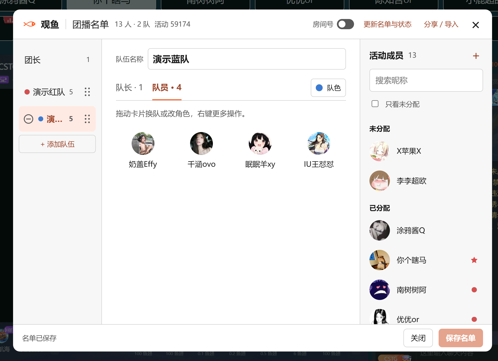

1. 从“设置 → 团播”打开名单，或在页面右侧的团播小鱼工具条中点“名单”。
2. 添加队伍，选中“队长”或“队员”，再点右侧成员加入。整张卡片都能拖动，右键可换队、改角色或编辑人物。
3. 给队伍选颜色，点“保存名单”，再切换“分组布局”。右侧成员的星形标记表示队长，圆点表示队员。

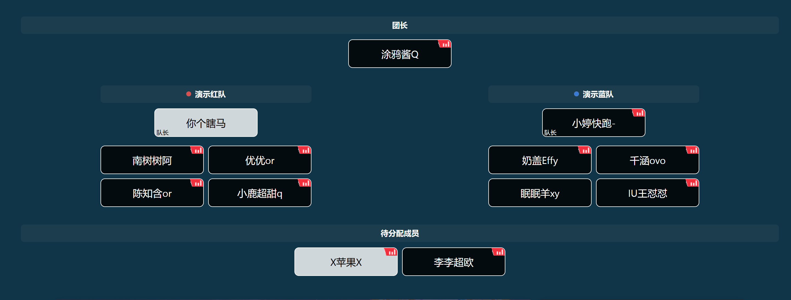

名单按活动保存，通过“分享 / 导入”与其他人共享。也可以输入房间号或直播间链接，添加活动名单以外的嘉宾。

在团播工具条中点“开启预览”，可以直接预览成员直播。预览默认静音，分组时优先显示独立人物和队长，“展开队员”可继续加入队员；双击画面可逐队放大。预览较多时会先确认数量，也可随时切回原始布局。

## 官方多屏扩展

斗鱼的官方多屏只在部分团播和活动直播间开放。观鱼复用这套播放器和选房功能，让任意直播间都能开启多屏。可用房间号或链接添加直播间，普通直播间最多四屏，包含当前房间。

在官方多屏的基础上，观鱼补充了副屏发声、独立音量、逐路画质和定点换房。默认只听一路，也可以开启独立音量，同时播放多路声音。

在“设置 → 多屏”中点“开启 / 编辑多屏”，选择候选房间；点“添加房间”可输入房间号或链接。候选会合并活动成员、关注和常用房间，添加候选后再选择播放。画面支持拖动排序。多屏增强默认开启，副屏由你手动选择后播放。

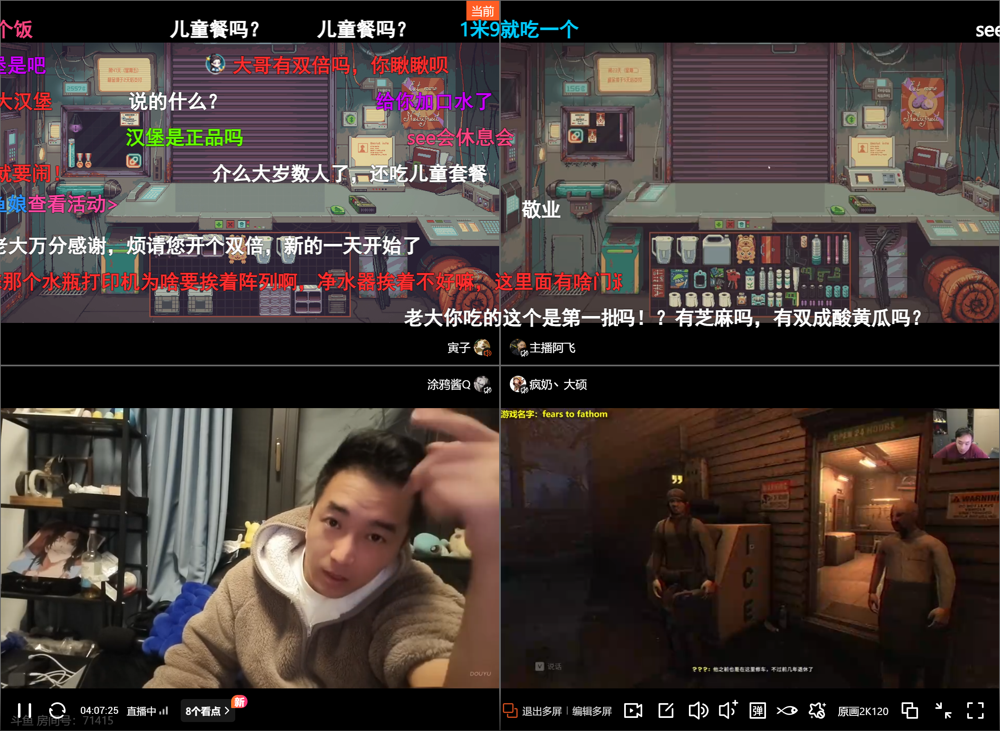

| 操作 | 怎么用 |
| --- | --- |
| 只听一路，默认模式 | 点主播头像上的喇叭切换发声房间，底部播放器音量控制这一路 |
| 分别调节每一路 | 开启“独立控制各直播间音量”，悬停头像显示滑条；底部音量作为总比例 |
| 切换画质 | 右键主播头像或名字，进入“清晰度”；只切换所选画面 |
| 原地更换副屏 | 右键副屏标签，选“更换直播间”，保留这个位置 |
| 减少标签遮挡 | 在多屏设置中选择始终显示、仅显示头像或全部隐藏；隐藏后悬停原头像位置可唤出 |

独立音量下，房间设为 60%、底部总音量为 50%，实际音量就是 30%。标签默认集中在画面交界处，也可以改到各画面左下角。取消最后一个副屏即可回到单屏。

选房面板将官方的大图横向列表改成两行紧凑缩略图，候选多时在面板里滚动；顶部列出已选房间，点名字旁的“×”即可取消，当前主房间保留。

查看近景：独立音量、画质和换房

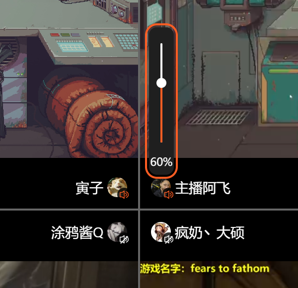

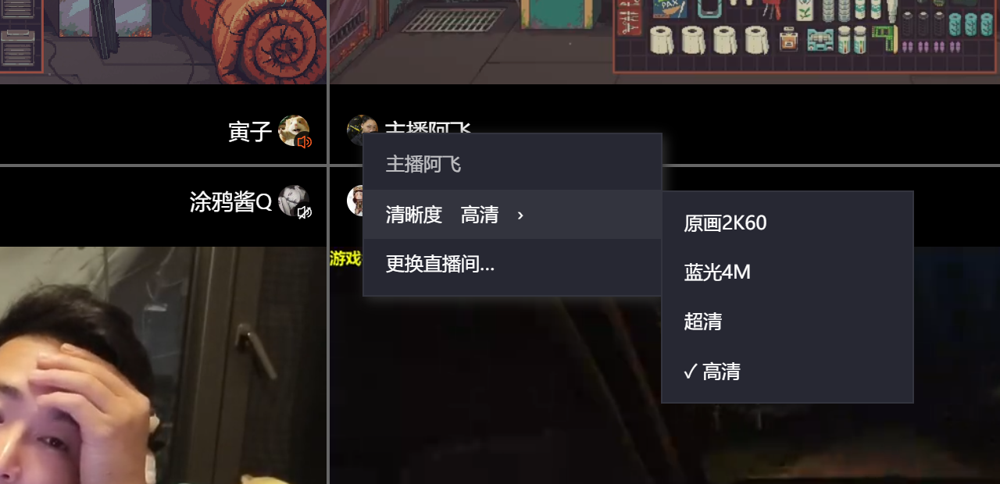

## 局部效果对比

| 功能 | 开启前 | 开启后 | 说明 |
| --- | --- | --- | --- |
| 紧凑选房与快速取消 | <a href="docs/images/multiscreen-picker-before.png">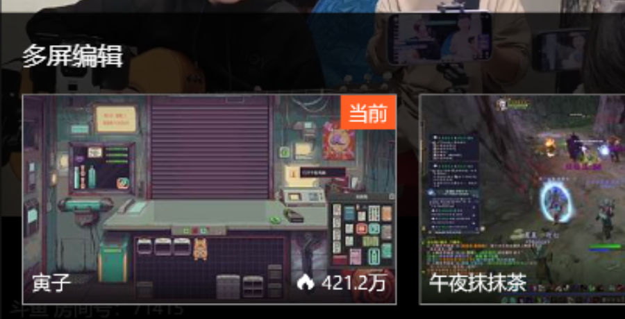</a> | <a href="docs/images/multiscreen-picker-after.png">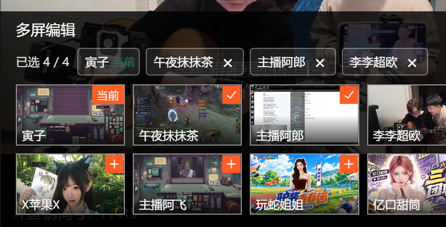</a> | 官方大图改成两行缩略图，顶部已选房间点“×”就能取消。 |
| 独立控制各直播间音量 | <a href="docs/images/multiscreen-volume-before.png">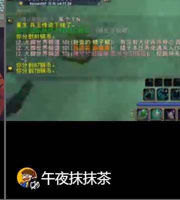</a> | <a href="docs/images/multiscreen-volume-after.png">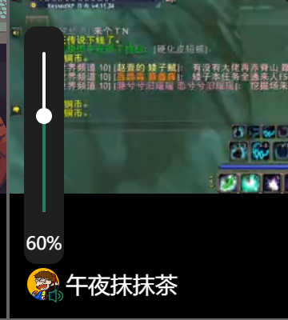</a> | 悬停头像调这一路，底部控件调总音量；音量跟随房间。 |
| 主播标签仅显示头像 | <a href="docs/images/multiscreen-avatar-before.png">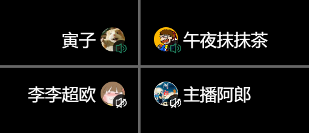</a> | <a href="docs/images/multiscreen-avatar-after.png">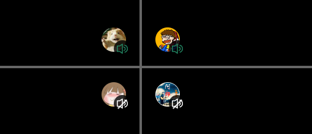</a> | 减少常驻遮挡，头像位置固定；另可选择全部隐藏、悬停唤出。 |

## 其他功能

- **声音与播放**：在播放器增益按钮上调额外音量，按房间记住选择；额外增益上限可设为 +100%～+500%。自动最高画质、网页全屏和滚轮调音量也可分别设置。
- **页面与弹幕**：按需保留顶图、礼物栏和活动内容，隐藏不想看的弹幕标记、进场提示或含链接消息。
- **背包与续牌**：查看道具到期、总价值和亲密度；从充值旁的荧光棒按钮打开计划，核对目标与数量后点“确认赠送”。本页会记录已送数量，再次确认仍会再送。
- **签到任务**：默认在后台处理鱼吧签到和粉丝牌每日弹幕等任务，可在设置中查看进度、关闭任务。客户端签到显示连续与累计签到天数、剩余补签次数及最近日期，同组独立开关控制自动补签，首次签到不消耗补签机会。星推荐红包默认每分钟检查当前房间，预计开抢前 2 秒开始连续抢领，成功、抢完或明确失败即停止，最晚在开抢后 2 秒结束。弹幕任务向当天未完成的持牌房间各发一条 `.`，同账号多个标签页共用任务池，最多两路并发。进度自动保存，关闭浏览器后下次继续。粉丝牌弹幕任务全部完成后，当天不再查询或发送，北京时间零点后重新开始。关闭设置窗口后后台任务继续运行。
- **快捷操作**：编排播放器右键菜单，快速开关礼物栏、镜像画面、查看主播配置或进入多屏。

各项默认值和行为规则见[功能说明](docs/FEATURES.md)。

## 待实现功能

- 复制直播流地址。

## 维护说明

只要我还在看斗鱼，观鱼就会继续维护。遇到问题或有功能建议，欢迎通过 [Issues](https://github.com/Virace2022/guanyu/issues) 反馈。

源码按 [MIT 许可](LICENSE) 开放，你可以继续使用、修改，或 Fork 后自行维护。

## 项目文档

| 文档 | 内容 |
| --- | --- |
| [详细功能列表](docs/FEATURE-LIST.md) | 按十一类设置逐项查功能、入口和用法 |
| [功能说明](docs/FEATURES.md) | 功能契约、默认值与限制 |
| [开发说明](docs/DEVELOPMENT.md) | 本地构建、开发调试与检查命令 |
| [发布说明](docs/RELEASING.md) | 日期版本、自动发布、安装与更新地址 |
| [工程架构](docs/ARCHITECTURE.md) | 模块职责、数据流、官方接口适配与生命周期 |
| [UI 规范](docs/UI.md) | 视觉与交互约定 |
| [开发约定](AGENTS.md) | 维护与验证要求 |

## 参考与致谢

观鱼的部分功能参考了小淳（[qianjiachun](https://github.com/qianjiachun)）的 [DouyuEx](https://github.com/qianjiachun/douyuEx)，感谢原作者的开发与开源。

由 [Virace](https://github.com/Virace2022) 开发，采用 [MIT 许可](LICENSE)。
